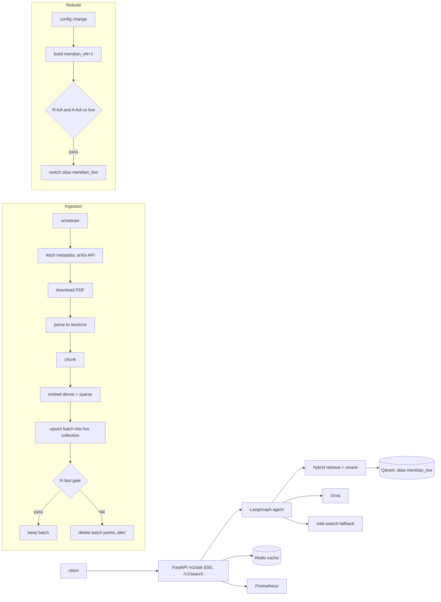

# Meridian

Meridian is a research assistant and retrieval service over a maintained corpus of arXiv
papers on LLM reasoning and evaluation. It answers with a citation to a specific paper section
after every sentence that states a fact. When the corpus does not support an answer, it says
so instead of guessing. When retrieval is weak, it rewrites the query, and it can fall back to
web search with clearly marked external sources. The corpus grows daily. Every index change is
versioned, and an index version goes live only if retrieval quality on a labeled query set
does not regress.

## Architecture



| Component | Implementation | Code |
|---|---|---|
| Corpus scope | Recorded arXiv query, 199 seed ids | `configs/corpus.yaml`, `configs/corpus_seed_ids.txt` |
| Fetch | One connection, one request per 3 s with jitter, Retry-After, backoff | `src/meridian/ingest/arxiv_client.py` |
| Parse | `pymupdf4llm` with `pypdf` fallback, references cut | `src/meridian/ingest/parse.py` |
| Chunk | Section-aware 400-token windows, 60 overlap | `src/meridian/ingest/chunk.py` |
| Index | `meridian_v{N}` with `dense` and `sparse` (BM25, IDF) vectors behind `meridian_live` | `src/meridian/ingest/index.py` |
| Retrieval | Two prefetches fused with RRF, cross-encoder rerank of 30 | `src/meridian/retrieval/hybrid.py` |
| Daily ingestion | Gated batches with rollback by `ingest_batch_id` | `src/meridian/ingest/pipeline.py`, `gate.py`, `scheduler.py` |
| Rebuilds | Full gate and atomic alias switch | `src/meridian/ingest/rebuild.py` |
| Agent | Route, rewrite, retrieve, grade, decide, generate, verify, finalize | `src/meridian/agent/` |
| Serving | SSE API, caches keyed by index revision, metrics, rate limits | `src/meridian/serving/` |
| Embedder | Synthetic pairs, hard negatives, fine-tuning, Hub release | `src/meridian/embedder/` |
| Releases | Snapshots on a private dataset repo, daily CI | `src/meridian/release/`, `.github/workflows/daily-index.yml` |
| Demo | Docker Space with an in-container Qdrant server | `space/` |

## Quickstart

Requires Python 3.11.9 through `uv`, Docker, and the keys listed in `.env.example`.

```bash
cp .env.example .env    # fill in GROQ_API_KEY, HF_TOKEN, HF_INDEX_REPO
make setup && make up && make demo
```

`make demo` restores the latest accepted index snapshot into the compose Qdrant and prints the
UI address (`http://127.0.0.1:8000/`). Reading the private snapshot repo requires `HF_TOKEN`
with read access. To build the index from scratch instead:

```bash
make backfill    # fetch, download, and parse the 199 seed papers
make index       # build meridian_v1 and point meridian_live at it
make ingest      # one gated incremental batch
```

## How it works

### Corpus and ingestion
`configs/corpus.yaml` records the exact query that produced the 199-paper corpus:
`cs.CL`, `cs.LG`, or `cs.AI`, six abstract terms, submissions from 2022 through 2024, sorted
by relevance. The backfill reproduces the corpus by versioned id. The corpus started broader
than it grows: daily additions now focus on LLM reasoning, calibration, and chain-of-thought
(abstracts that mention "large language model" together with one of those three terms), which
keeps a typical day under 40 papers. Pure benchmark and evaluation-methodology papers are no
longer added unless they match that clause (D-009). Daily increments query by
submission date from the last accepted watermark, oldest first and capped per run. A three-day
lookback absorbs arXiv's announcement delay, and newer versions of corpus papers replace older
ones after the gate accepts the batch (`docs/runbook.md`).

### Index and retrieval
Each index version is one collection with a dense vector (`BAAI/bge-small-en-v1.5`, cosine)
and a sparse BM25 vector (`Qdrant/bm25` with Qdrant's IDF modifier). A query runs both as
prefetches of 50 in one `query_points` call, fuses them with RRF (k=60), and reranks the fused
top 30 with `BAAI/bge-reranker-base` to the final 6. Payloads keep the chunk's character span
in the parsed paper, which keeps labeled evaluation spans valid across chunker changes.

### Gates
After a daily batch, R-fast (40 labeled queries) runs through the full pipeline. If recall@5
drops more than 0.02 below the stored baseline, every point of the batch is deleted, the batch
is recorded as rejected, and an alert is raised. A rebuild into `meridian_v{N+1}` compares
R-full recall@5 and nDCG@10 and A-full faithfulness with the live version. The alias moves in
one request only when no metric is worse by more than its tolerance.

### Agent
The router answers, asks for clarification, or refuses out-of-scope requests by naming the
corpus topic. Grading keeps chunks whose reranker score is at least 0.7 and drops those below
0.2. Only the band in between goes to the fast-tier grader (`openai/gpt-oss-20b`). With fewer than two supporting chunks,
the agent rewrites the query up to twice, then falls back to web search if enabled, else
declines. The generator cites short aliases that are resolved to chunk ids afterwards. The
verifier drops citations outside the context, judges cited sentences with a different model,
and removes unsupported sentences or regenerates once. Per-turn state is reset at the start of
every turn; only messages and a pinned paper filter persist.

### Serving
`POST /v1/ask` streams tokens and the final cited answer as server-sent events.
`POST /v1/search` returns ranked chunks. `/healthz`, `/readyz`, `/metrics`, and `/v1/index`
report health, readiness, Prometheus metrics, and the live index. Answers are cached by
normalized question and index revision, so an index change never serves a stale answer.

### Domain-adapted embedder
Ten thousand synthetic query and chunk pairs from papers in no evaluation set train the dense
model with `MultipleNegativesRankingLoss` and mined hard negatives. The adapted model goes
live only through the rebuild gate.

### Scheduled releases
A daily GitHub Actions job restores the latest accepted snapshot, ingests new papers, runs the
R-fast gate, and publishes a new snapshot to the private dataset repo only when the gate
passes. Otherwise it opens an issue. Each run appends to `results/ingest_runs.jsonl`. The job
skips itself unless the `HF_TOKEN` secret and the `HF_INDEX_REPO` variable are set and a
first snapshot exists in the dataset repo.

### Demo Space
`space/` holds a Docker Space image that runs the API, the UI, and a Qdrant server in one
container. At startup it restores the latest accepted snapshot and checks for a newer one
every hour. Citations show at most two sentences of excerpt and link to the arXiv abstract
page, web fallback is disabled, and requests are limited to 10 per minute and 100 per day per
address. A Docker Space requires a paid Hugging Face plan. A Space on free hardware sleeps when idle,
so the first request after a pause waits for a cold start. `make deploy-space` uploads the Space files.

## Evaluation

Datasets live under `eval/` and are described in `eval/README.md`: the retrieval set R (150
synthetic questions with span labels, 30 reviewed by hand, R-fast is 40 of them), the answer
set A (75 questions, A-fast is 20, with reference answers drafted by
`scripts/build_answer_references.py` and reviewed by hand), and the out-of-scope set O (25
questions). The judge model is never the generator model. Each experiment writes one JSON
file under `results/` that records the run id, git SHA, config path and hash, and
environment. `make results` renders the tables for the files that exist into the marked
blocks below, and `make results-check` verifies that the README matches them.

<!-- results:headline:start -->
<!-- results:headline:end -->

### E1: retrieval quality and stage latency (`make eval-retrieval`)
Recall@5, recall@10, MRR@10, and nDCG@10 on R-full, with p50 and p95 latency per stage, for
dense only, BM25 only, hybrid RRF, hybrid RRF plus rerank, and the previous in-process BM25
path. It also varies the prefetch limit and the chunk size. Output: `results/e1_retrieval.json`.
<!-- results:e1:start -->
<!-- results:e1:end -->

### E2: answer quality (`make eval-answers`)
RAGAS faithfulness, response relevancy, context precision with reference, and context recall
on A, plus citation precision, the unsupported-sentence rate, and refusal accuracy on O.
Output: `results/e2_answers.json`.
<!-- results:e2:start -->
<!-- results:e2:end -->

### E3: serving latency, cost, and caches (`make eval-serving`)
End-to-end latency, tokens, cost, and LLM calls per answer with and without score-band
grading, cache hit rates, and the semantic cache wrong-hit rate. Output:
`results/e3_serving.json`.
<!-- results:e3:start -->
<!-- results:e3:end -->

### E4: daily ingestion (`make eval-ingest`)
Seven simulated daily batches replayed from historical dates, with papers, chunks, failures,
gate decisions, and the recall@5 trajectory, plus the record of every scheduled workflow run
from `results/ingest_runs.jsonl`. Output: `results/e4_ingest.json`.
<!-- results:e4:start -->
<!-- results:e4:end -->

### E5: domain-adapted embedder (`make eval-embedder`)
The base and adapted embedding models on R-full for dense only and for the full pipeline,
with training time, hardware, and the rebuild gate decision. Output:
`results/e5_embedder.json`.
<!-- results:e5:start -->
<!-- results:e5:end -->

### E6: public demo (`make eval-demo`)
Cold start time, p50 and p95 latency for 20 scripted questions, and rate-limit behavior of a
deployed Space. Output: `results/e6_demo.json`.
<!-- results:e6:start -->
<!-- results:e6:end -->

## Design decisions

Full context and alternatives are in [DECISIONS.md](DECISIONS.md).

- D-001: BM25 moves into Qdrant, so one versioned collection holds both retrieval sides.
- D-002: Chunk payloads carry character spans, so labels survive chunker changes.
- D-003: Increments advance an oldest-first watermark with a lookback and a version check.
- D-004: The backfill reproduces the recorded corpus by versioned id.
- D-005: Training pairs come only from papers outside every evaluation set.
- D-006: Releases restore into a fresh copy, and caches key on the index revision.
- D-007: The demo Space runs the Qdrant server binary next to the API.

## Limitations

- **Synthetic retrieval labels.** R's questions are written by an LLM from single chunks, so
  they favor lexical overlap with their source. The overlap filter and the manual review of 30
  items reduce this bias toward BM25 without removing it.
- **Daily scope narrowed.** The recorded topic query matched 398 submissions on a single day
  (2026-10-08), so daily additions use the narrowing clause of D-009. Its median is 24.5
  matches a day, and 4 of the last 30 days exceeded the 40-paper cap, so bursts take about two
  days to clear. The corpus therefore drifts toward reasoning, calibration, and
  chain-of-thought papers, and the R-fast gate does not measure that drift.
- **Corpus gap.** Papers submitted between the backfill's 2024-12-31 ceiling and the backfill
  date are not in the corpus (D-004).
- **Baseline drift.** As SPEC S3.6 requires, the R-fast baseline is updated after every
  accepted batch. Small regressions within 0.02 can therefore accumulate over many batches.
- **Uncited sentences are removed.** The verifier treats an uncited sentence as unsupported,
  which can drop connective sentences; E2 reports the unsupported-sentence rate.
- **Score bands are not tuned.** The accept and reject reranker scores (0.7 and 0.2) are set a
  priori.
- **Shared inference provider.** The generator and the judge are different models but both run
  on Groq.
- **Single topic.** Results describe this corpus and question set only.

## Repository layout

```
src/meridian/
  ingest/      arxiv_client  pdf parsing  chunk  embed  index  manifest  build  pipeline  gate  scheduler  rebuild
  retrieval/   hybrid  rerank  legacy (E1 baseline)  factory
  agent/       state  nodes/  citations  build  prompts/  web
  serving/     app  sse  cache  rate_limit  runtime  ui/
  embedder/    build_pairs  mine_negatives  train  card  exclusion
  release/     snapshot  publish  restore  runlog  watcher
  eval/        build_retrieval_set  retrieval_eval  answer_eval  serving_eval  ingest_eval  embedder_eval  demo_eval
  common/      settings  config  llm_client  metrics  logging  results
configs/       one YAML file per concern, each with a version
eval/          committed datasets R, A, O, and cache probes
results/       committed results artifacts and the scheduled run log
scripts/       review, references, load test, Space deploy, README rendering
space/         Docker Space image and startup
slurm/         GPU training job
tests/         unit, integration (compose Qdrant), e2e (recorded LLM responses)
docs/          architecture and ingestion runbook
```

## License

MIT for the source code. The arXiv papers keep their authors' licenses; chunk text and PDFs
are never committed, and index snapshots are published only to a private repository.
